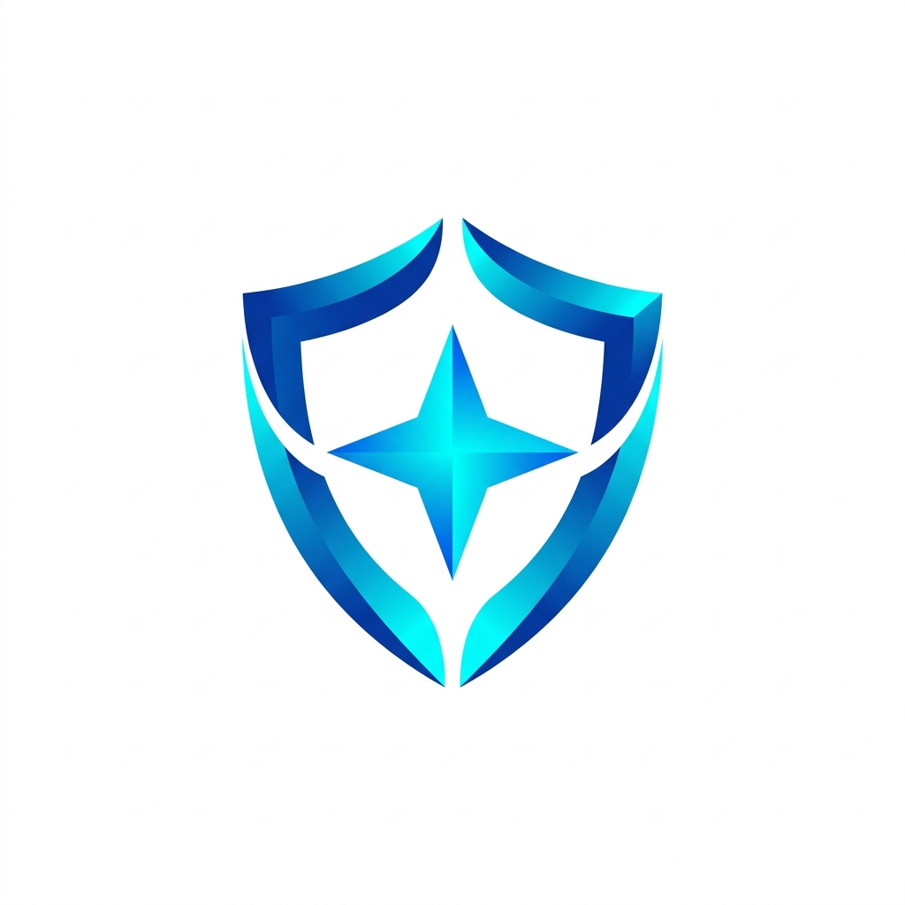

<p align="center">
  
</p>

<h1 align="center">MY RESILIENCE</h1>

<p align="center">
  <strong>Model Cybercounseling Berfokus Solusi Berbantuan Self-Help untuk Meningkatkan Resiliensi pada Remaja dengan Kerentanan Psikologis</strong>
</p>

<p align="center">
  
  
  
  
  
  
</p>

---

## 📌 Tentang MY RESILIENCE

**MY RESILIENCE** adalah platform kesehatan mental dan bimbingan konseling digital berbasis website yang dirancang khusus sebagai media layanan **Model Cybercounseling Berfokus Solusi (*Solution-Focused Brief Counseling* / SFBC) Berbantuan Self-Help untuk Meningkatkan Resiliensi pada Remaja dengan Kerentanan Psikologis**.

Di platform ini, remaja (konseli) tidak diajak untuk terus berfokus pada masalah atau kegagalan masa lalu, melainkan didampingi untuk mengenali kekuatan diri, menemukan pengecualian positif (*exception*), merumuskan jalan keluar, dan melangkah menuju masa depan yang diharapkan.

Platform ini didukung oleh **KEMENDIKTI SAINTEK (Saintek Berdampak)** bekerja sama dengan **Departemen Bimbingan dan Konseling, Fakultas Ilmu Pendidikan, Universitas Negeri Malang (UM)**.

---

## 🚀 Fitur Utama

### 📊 1. Instrumen Resiliensi Interaktif (Pre-Test & Post-Test)
* Pengukuran tingkat resiliensi remaja sebelum (*Pre-Test*) dan sesudah (*Post-Test*) mengikuti sesi *self-help*.
* Pengisian kuesioner interaktif yang responsif dengan penyimpanan jawaban otomatis (*auto-save*).
* Kalkulasi skor otomatis beserta kategori interpretasi tingkat resiliensi dari sistem.
* Ekspor laporan hasil analisis resiliensi dalam format **PDF** yang rapi dan siap diunduh.

### 🧩 2. Modul Digital Self-Help Berbasis SFBC-Resiliensi
Terdiri dari **5 Modul Utama Resiliensi** yang dirancang untuk membangun ketangguhan psikologis remaja:
1. **Modul Regulasi Diri** (*Self Regulation*: Mengelola Emosi & Ketenangan Diri)
2. **Modul Kapasitas Adaptif** (*Adaptive Capacity*: Menyesuaikan Diri & Bangkit dari Kegagalan)
3. **Modul Pemecahan Masalah** (*Problem Solving Competence*: Mencari Jalan Keluar & Fokus Solusi)
4. **Modul Keterikatan Sosial** (*Social Connectedness*: Membangun Hubungan & Keberanian Meminta Bantuan)
5. **Modul Orientasi Pertumbuhan** (*Growth Orientation*: Semangat Belajar & Pemanfaatan Digital Positif)

### ✍️ 3. Lembar Kerja Refleksi 5 Tahapan SFBC
Setiap modul dilengkapi lembar kerja interaktif dengan *auto-save* yang mengikuti tahapan **Solution-Focused Brief Counseling (SFBC)**:
* **Tahap 1 — Tujuan (*Goal Setting*)**: Merumuskan tujuan dan harapan perubahan positif yang konkret.
* **Tahap 2 — Penemuan Exception (*Exception Finding*)**: Menggali pengalaman keberhasilan di masa lalu saat mampu mengatasi situasi serupa.
* **Tahap 3 — Pelaksanaan Solusi (*Solution Building*)**: Memilih strategi atau tindakan paling cocok untuk diterapkan kembali.
* **Tahap 4 — Scaling (*Scaling Questions*)**: Mengukur posisi keyakinan/ketangguhan pada skala `1–10` beserta langkah kecil untuk naik satu tingkat.
* **Tahap 5 — Tugas (*Action Plan / Misi Hari Ini*)**: Menyusun rencana aksi nyata dan sederhana yang siap dilakukan.

### 🤝 4. Alur Cybercounseling & Pendampingan Konselor
* Konseli dapat memilih konselor pendamping yang terdaftar di dalam sistem dan terhubung langsung melalui integrasi komunikasi (WhatsApp).
* Konselor dapat memantau progres pengisian instrumen resiliensi (*Pre-Test* & *Post-Test*), meninjau jawaban refleksi *self-help* konseli, serta mereset tes apabila diperlukan.
* Rujukan sesi konseling lanjutan bersama konselor sekolah jika dibutuhkan pendampingan lebih mendalam.

### 📚 5. Ruang Materi Pembelajaran (Lessons) & Panel Administrasi
* **Pembelajaran Interaktif**: Penyediaan materi edukasi tambahan (teks, artikel, dan media pembelajaran) yang dikelola oleh Konselor dan Admin untuk Konseli.
* **Panel Administrator Komprehensif**: Manajemen pengguna multi-peran (*Admin*, *Konselor*, *Konseli*), pengelolaan bank soal instrumen & grup opsi, manajemen rentang skor interpretasi, serta pengaturan modul dan pertanyaan *self-help*.

---

## 🧭 8 Langkah Penggunaan (Alur Konseli)

1. **Registrasi Akun**: Mendaftarkan akun baru sebagai konseli pada platform.
2. **Masuk (Log-in)**: Masuk ke dalam dashboard konseli melalui menu *Log-in*.
3. **Memilih Konselor**: Memilih konselor pendamping selama mengikuti rangkaian layanan.
4. **Pre-Test Resiliensi**: Mengisi instrumen resiliensi awal sebelum mengikuti sesi *self-help*.
5. **Sesi Self-Help**: Mengerjakan modul *self-help* interaktif berbasis SFBC-Resiliensi.
6. **Post-Test Resiliensi**: Mengisi instrumen resiliensi akhir setelah menyelesaikan sesi *self-help*.
7. **Komunikasi Hasil**: Mengkomunikasikan hasil pengerjaan *self-help* dan instrumen bersama konselor pendamping.
8. **Tindak Lanjut**: Menghubungi konselor sekolah jika dibutuhkan sesi konseling lanjutan.

---

## 🛠️ Arsitektur & Teknologi

* **Backend Framework**: Laravel 13.x (PHP 8.3+)
* **Database**: MySQL / MariaDB / SQLite
* **Frontend Stack**:
  * Blade Templating Engine
  * Tailwind CSS (Desain sistem warna 60-30-10: *Crisp White*, *Royal Blue*, *Luminous Cyan*)
  * Alpine.js (Reaktivitas komponen interaktif & *auto-save*)
* **Build System**: Vite
* **PDF Export Engine**: `barryvdh/laravel-dompdf`

---

## 📂 Struktur Direktori Utama

```text
myresilience/
├── app/
│   ├── Http/
│   │   └── Controllers/     # Controller (Auth, Admin, Konselor, Konseli)
│   └── Models/              # Model Eloquent ORM (User, Question, Tribe, Material, Lesson, dll.)
├── database/
│   ├── migrations/          # Skema tabel database
│   └── seeders/             # Data awal (Admin, Konselor, Soal Resiliensi, Modul SFBC-Resiliensi)
├── public/
│   ├── build/               # Aset terkompilasi Vite
│   └── image/               # Aset visual, logo institusi, ilustrasi hero, dan foto tim
├── resources/
│   ├── css/                 # Stylesheet utama & konfigurasi Tailwind CSS
│   ├── js/                  # Inisialisasi JavaScript & Alpine.js
│   └── views/               # Template Blade
│       ├── admin/           # Antarmuka Panel Administrator
│       ├── konseli/         # Antarmuka Panel Remaja/Konseli
│       ├── konselor/        # Antarmuka Panel Konselor Pendamping
│       ├── layouts/         # Layout dasar platform (Base, Guest, Sidebar per Role)
│       └── landing.blade.php # Halaman utama (Landing Page) MY RESILIENCE
└── routes/
    ├── web.php              # Definisi routing utama berdasarkan role
    └── auth.php             # Definisi routing autentikasi
```

---

## 🔧 Panduan Instalasi Lokal

Ikuti langkah-langkah berikut untuk menjalankan proyek **MY RESILIENCE** di lingkungan lokal Anda:

### 1. Prasyarat
Pastikan perangkat Anda telah terinstal:
* PHP >= 8.3
* Composer
* Node.js & NPM
* MySQL / MariaDB

### 2. Kloning Repositori
```bash
git clone <url-repository-anda> myresilience
cd myresilience
```

### 3. Instalasi Dependensi PHP & JavaScript
```bash
composer install
npm install
```

### 4. Konfigurasi Lingkungan (`.env`)
Salin berkas `.env.example` menjadi `.env`:
```bash
cp .env.example .env
```
Sesuaikan konfigurasi database di dalam berkas `.env`:
```env
APP_NAME="MY RESILIENCE"
APP_URL=http://localhost:8000

DB_CONNECTION=mysql
DB_HOST=127.0.0.1
DB_PORT=3306
DB_DATABASE=myresilience
DB_USERNAME=root
DB_PASSWORD=
```

### 5. Generate Application Key & Symbolic Link Storage
```bash
php artisan key:generate
php artisan storage:link
```

### 6. Migrasi Database & Seeder Data Awal
Perintah ini akan membuat seluruh tabel dan mengisi data awal (akun Admin, akun Konselor, instrumen kuesioner resiliensi, serta 5 Modul Self-Help SFBC-Resiliensi):
```bash
php artisan migrate --seed
```

### 7. Menjalankan Server Pengembangan
Anda dapat menjalankan seluruh layanan pengembangan sekaligus menggunakan skrip Composer:
```bash
composer run dev
```
Atau menjalankannya secara terpisah di dua terminal:
```bash
# Terminal 1: Menjalankan server aplikasi Laravel
php artisan serve

# Terminal 2: Menjalankan compiler aset Vite
npm run dev
```
Buka browser dan akses aplikasi pada alamat `http://localhost:8000`.

---

## 👥 Tim Peneliti & Pengembang

Platform ini dikembangkan oleh tim peneliti dan pengembang dari **Universitas Negeri Malang (UM)**:

1. **Prof. Dr. M. Ramli, M.A** — *Departemen Bimbingan dan Konseling FIP UM*
2. **Prof. Dr. Nur Hidayah, M.Pd** — *Departemen Bimbingan dan Konseling FIP UM*
3. **Dr. Nur Eva, M.Psi., Psikolog** — *Fakultas Psikologi Universitas Negeri Malang*
4. **Dr. Nur Mega Aris Saputra, S.Pd., M.Pd** — *Departemen Bimbingan dan Konseling FIP UM*
5. **Muh Khoiruddin Jalil, S.Pd., M.Pd** — *Departemen Bimbingan dan Konseling FIP UM*
6. **Muh. Nur Alamsyah, S.Pd., M.Pd** — *Departemen Bimbingan dan Konseling FIP UM*

---

## 📞 Kontak & Informasi Institusi

* **Institusi**: Departemen Bimbingan dan Konseling, Fakultas Ilmu Pendidikan, Universitas Negeri Malang (FIP UM)
* **Alamat**: Jl. Semarang No. 5, Kota Malang, Jawa Timur
* **Telepon / WhatsApp**: [+62 812-3175-0634](https://wa.me/6281231750634)
* **Email**: [aris.saputra.fip@um.ac.id](mailto:aris.saputra.fip@um.ac.id)

---

## 📄 Lisensi & Hak Cipta

Platform ini dikembangkan dan dirilis untuk kepentingan akademis, riset, layanan bimbingan konseling, dan pengabdian masyarakat di bawah naungan **KEMENDIKTI SAINTEK** dan **Universitas Negeri Malang (UM)**. Hak Cipta Dilindungi Undang-Undang.
